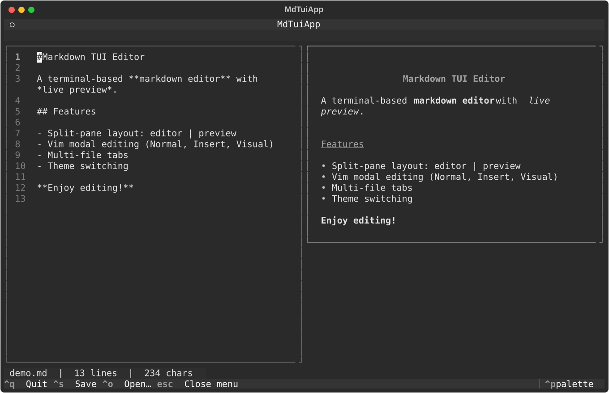

# Markdown TUI Editor

A terminal markdown editor with a **live split-pane preview** and a clickable,
GUI-style menu bar — all drawn with [Textual](https://textual.textualize.io/).



## Features

- **Split pane**: `TextArea` editor on the left, rendered Markdown preview on the right, updated as you type
- **Menu bar**: clickable File / Theme / Help menus with dropdowns
- **Open & save** through in-app dialogs (file browser + filename prompt)
- **5 themes**: Dracula, Nord, Gruvbox, Catppuccin, Solarized
- **Line numbers** in the editor

## Requirements

- Python **3.10+** (the code uses `str | None` annotations)
- [`textual`](https://textual.textualize.io/) — pinned in `requirements.txt`

## Install & run

```bash
git clone https://github.com/navioski/markdown-tui.git
cd markdown-tui

# with uv (recommended)
uv run main.py            # empty document
uv run main.py demo.md    # open a file

# or plain pip
python3 -m venv .venv
.venv/bin/pip install -r requirements.txt
.venv/bin/python main.py demo.md
```

## Keys

| Key | Action |
|---|---|
| <kbd>Ctrl</kbd>+<kbd>S</kbd> | save |
| <kbd>Ctrl</kbd>+<kbd>O</kbd> | open a file |
| <kbd>Ctrl</kbd>+<kbd>Q</kbd> | quit |
| <kbd>Esc</kbd> | close the open menu |

Themes are switched from the **Theme** menu (or in code via `app.theme = "nord"`).

## Roadmap

Earlier versions of this README claimed two features that are **not** in the
code today — listing them here instead of pretending:

- **Multi-file tabs** — the app holds a single document. Textual ships
  `TabbedContent`, so this is a contained change.
- **Vim modal editing (Normal/Insert/Visual)** — Textual's `TextArea` has no vim
  mode (verified against textual 8.2.8), so this would need a custom key layer.

## Verified

Tested on **Python 3.14.5 + textual 8.2.8** (macOS, 2026-11).
